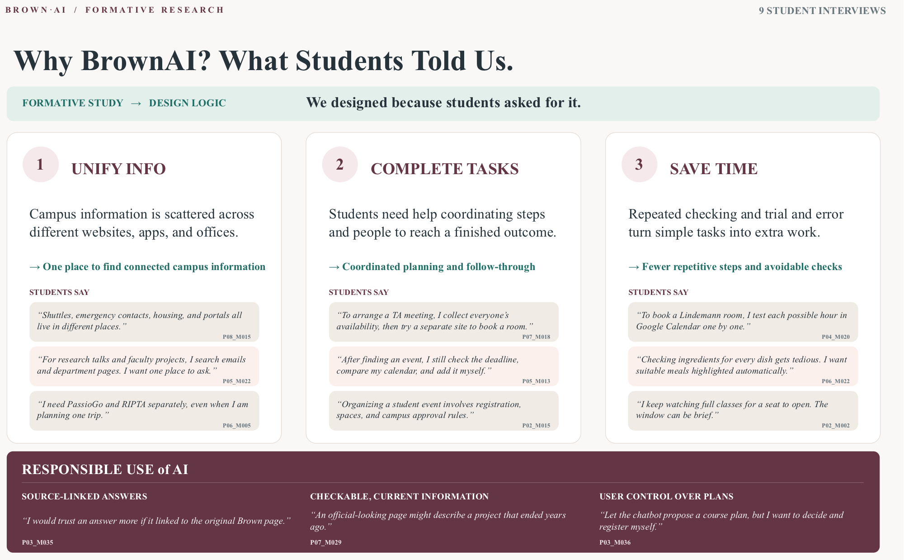

[](Takeaway.pdf)

## Run locally

**Option 1:** Double-click `index.html` to open it in your browser. You don't need to install anything, start a server or have an internet connection.

**Option 2:** Start a local server from this folder:

```bash
python3 -m http.server 8000
```

Then open http://localhost:8000.
